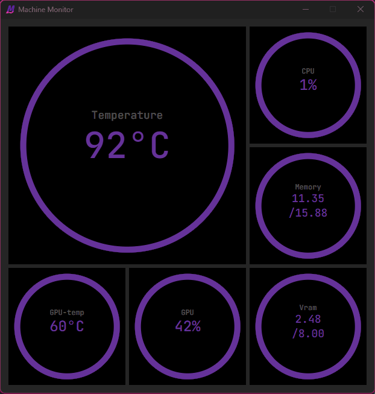

# Monitor de Máquina
Este es un programa de monitoreo mínimo cuyo objetivo es utilizar la menor cantidad de recursos posible
Visualiza la temperatura y otra información sobre la máquina actual.

El binario ejecutable y el instalador (.msi) se encuentran en los lanzamientos --->

Solo se soporta Windows y Nvidia para la información gráfica



## Limitación de Hardware
Este programa está diseñado específicamente para funcionar en máquinas Windows con tarjetas gráficas Nvidia.
Esto podría ampliarse en el futuro.

## Resumen

### Front-End
Este programa se ha creado utilizando el framework de Rust `Tauri` con una implementación pura en HTML, CSS y JS.

### Back-End
El back-end utiliza multithreading. Un hilo ejecuta toda la comunicación con las APIs de Windows y Nvidia para obtener todos los datos para el front-end, y el hilo principal de Rust toma los datos de las APIs y los envía al front-end.

Gran parte de la implementación del back-end se encuentra en mi crate de Rust `qmstats`, el cual se puede encontrar en: https://github.com/AlbinDalbert/qmstats
## Compilación
Este proyecto se construye con Tauri; para compilarlo, sigue los pasos de configuración para Tauri usando `cargo` en https://tauri.app/.
Para construir una versión de desarrollo, usa el siguiente comando:

```$ cargo tauri dev```

Para construir una versión de lanzamiento, usa lo siguiente:

```$ cargo tauri build```

### TODO
- [ ] registro de eventos/logging (cuando esté instalado, no como binario independiente)
- [ ] agregar archivo de configuración
- [ ] posibilidad de cambiar la frecuencia de actualización
- [ ] página "Acerca de"
- [ ] mostrar la versión en la interfaz de usuario (UI)
